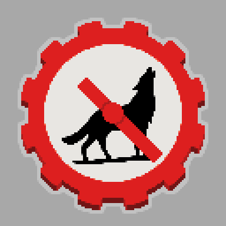

# Better With Time

Better With Time is a **tech-focused** adaptation of the [Better Than Wolves](https://modrinth.com/mod/btwce) mod for modern versions of Minecraft (1.21+). Though not as direct of an inspiration, it also shares many similarities with [Better With Mods](https://www.curseforge.com/minecraft/mc-mods/bwm-suite).

Better Than Wolves pioneered many technical blocks, items, and mechanics that overhauled the way players build, automate, and farm resources. Better With Time seeks to bring that classic, 2011-2012 experience to the modern Minecraft environment.

##  Installation and Setup

Better With Time requires the [Fabric Loader](https://fabricmc.net/use/installer/) and the [Fabric API](https://modrinth.com/mod/fabric-api) mod to run.
See the instructions for installing Fabric mods on the Fabric website for further setup instructions. 

## ⚙️Tech-Focused, not Hardcore

An important note: Due to changes to the mod and viral YouTube videos, Better Than Wolves, in recent years, has taken on a new identity of being a brutally challenging, early game survival experience first, tech mod second.
Better With Time does not, and will not ever replicate these features. It will not materially affect your ability to survive the early game.

Better With Time's design goals are entirely focused on delivering a satisfying, cohesive "Technical Minecraft" experience.

## 🤝 Mod Compatibility

Better Than Wolves was notoriously incompatible with most other mods. Better With Time, however, aims to be as compatible with other mods as possible.
If you encounter compatibility issues with another mod, please follow the instructions below for reporting an issue.

## 📝 License

[Better With Time](https://github.com/RatherBeLunar/BetterWithTime) © 2025 by [RatherBeLunar](https://github.com/RatherBeLunar/BetterWithTime) is licensed under CC BY 4.0

This project is made possible by the work of FlowerChild, the original developer of Better Than Wolves.
Though Better With Time is largely a complete rewrite from scratch, it utilizes image assets, as well as references some specific values and functions directly from FlowerChild's release of the Better Than Wolves source code, obtained [here](https://forum.btwce.com/viewtopic.php?t=9863).

## 💜 Contributors

Better With Time began as a solo project, but has since received some awesome contributions from other folks:

- [Primetoxinz](https://github.com/primetoxinz), one of the primary devs of Better With Mods, contributed several code features, including EMI integration
- Stohun on Discord made the mod's logo, and retextured and remodeled several blocks.
- Ikabod on Discord made the stoked fire's animated texture

## 🐞 Bugs

If you encounter a bug, incompatibility, or other problem during your gameplay of BWT, please [check for an existing issue on GitHub](https://github.com/RatherBeLunar/BetterWithTime/issues), and if one doesn't exist, submit an issue yourself describing the problem.
Please include the list of mods and their version numbers that you're using, or the issue may not get resolved. 

